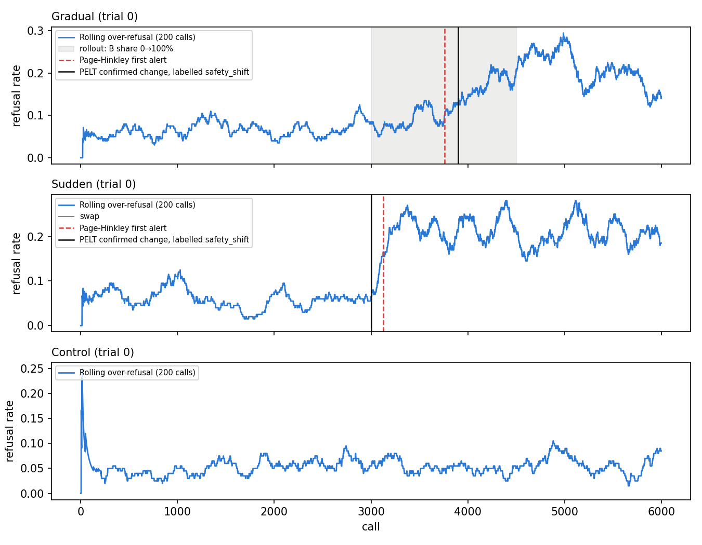

# Gradual drift from real LMSYS-Chat-1M responses (staged model rollout)

vicuna-13b → llama-2-13b-chat, safe (moderation-unflagged) English prompts. Calls 1–3000 all A; calls 3001–4500 B's share rises 0→100%; then all B until call 6000. Sudden trials swap at call 3001; controls are all A. 30 trials each, fresh random conversations per trial (resamples of one dataset, not independent deployments).

Over-refusal: 0.055 (vicuna-13b) → 0.208 (llama-2-13b-chat).

Both paths run per call through driftguard/detection/pipeline.py: Page-Hinkley (λ = 12 scaled to the signal's noise, α = 0.998, first
alarm) and PELT → permutation test on adjacent segments → Benjamini-Hochberg, each confirmed
change labelled by classification/rules.py. A label counts as placed if it lies in the change
window (the ramp, or the step) ± 75 calls.

|                                                 | gradual   | sudden   | control   |
|:------------------------------------------------|:----------|:---------|:----------|
| trials                                          | 30        | 30       | 30        |
| PH detection rate                               | 100%      | 97%      | –         |
| PH false alarm (before change / any on control) | 0%        | 3%       | 0%        |
| PH delay, median (calls after change starts)    | 730       | 119      | –         |
| PH delay, IQR                                   | 630–777   | 92–153   | –         |
| safety_shift label (any place)                  | 100%      | 100%     | 0%        |
| safety_shift label in change window             | 100%      | 100%     | –         |

